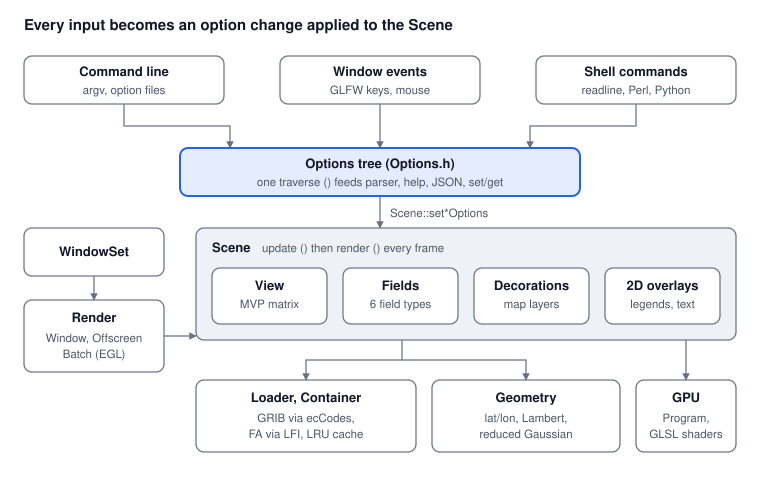
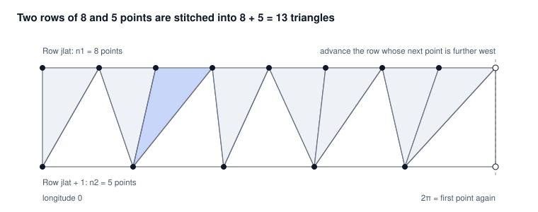
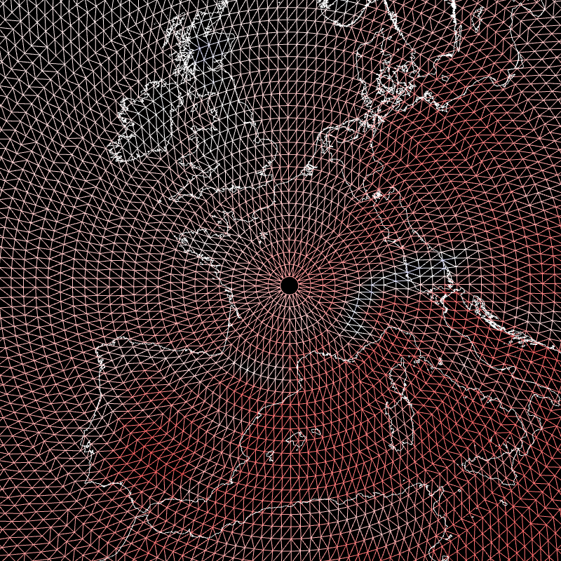
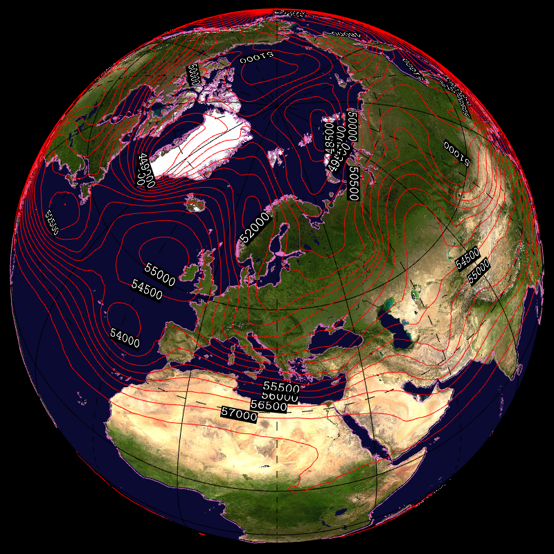
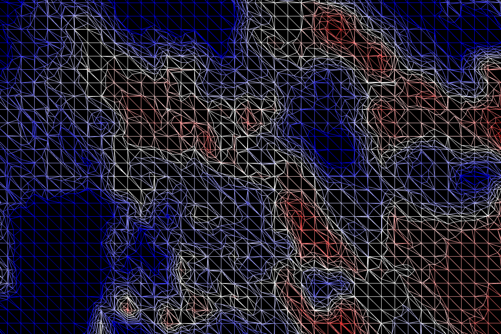
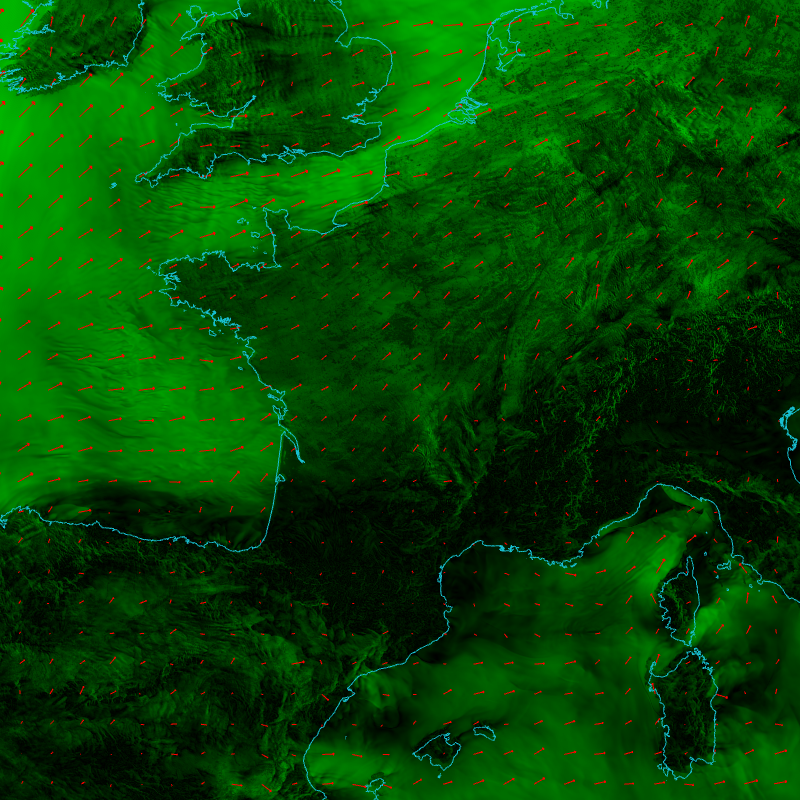
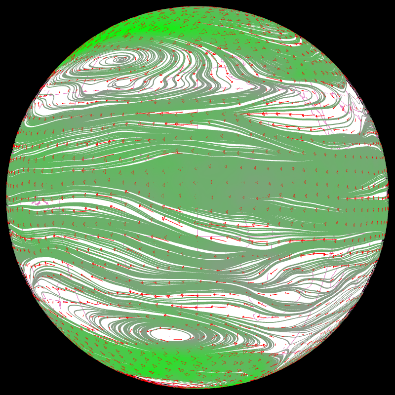
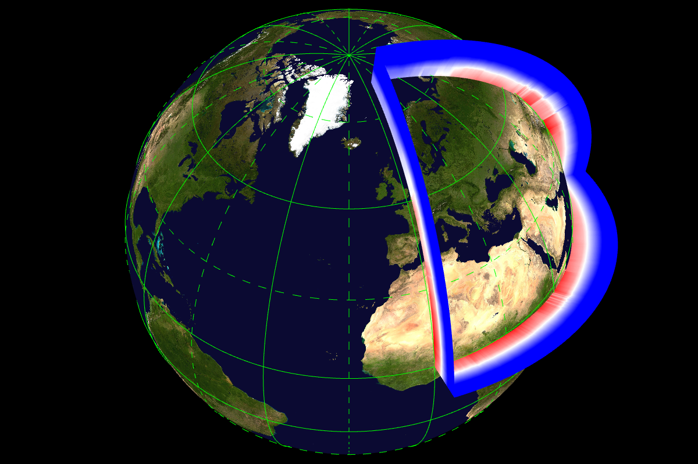
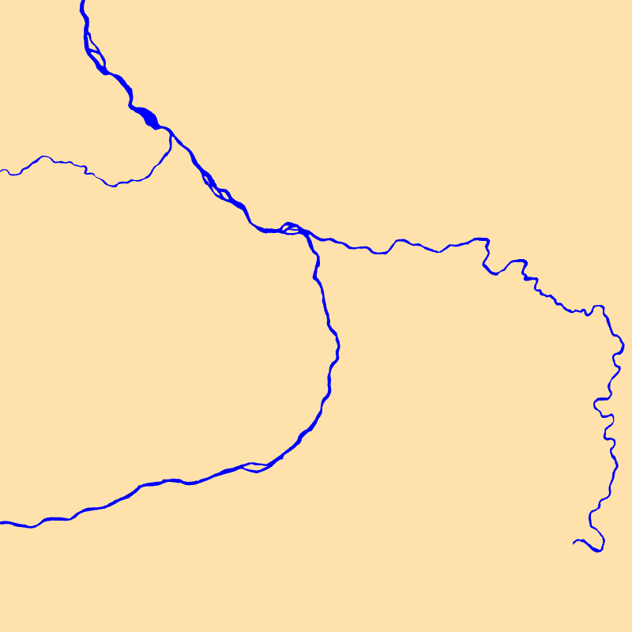

# glgrib — Technical Documentation

Philippe Marguinaud · last updated 2026-11-26

## 1. Overview

glgrib is a C++11 / OpenGL 4.4 core-profile program (shaders are `#version 440 core`) that draws meteorological fields (GRIB2 via ecCodes, FA via the bundled LFI library) on a 3D globe or a flat projection. It is built twice from the same sources: once against GLFW for interactive windows, once against EGL + GBM for headless batch rendering without an X server.

The code is organised as a shared library (`libglGrib-<backend>.so`) plus a very small `main` (`src/glGrib/glGrib.cc`, 40 lines). Everything else — scene graph, data loading, geometry, rendering, shell — lives in the library and is reused by the Perl, Python and Perl/Tk front-ends.

### Build variants

`src/glGrib/makefile` runs itself twice with `BUILD=glfw` and `BUILD=egl`. Objects go to `src/glGrib/glfw/` and `src/glGrib/egl/`; the only compile-time difference is `-DGLGRIB_USE_GLFW` or `-DGLGRIB_USE_EGL`.

| Artefact | Built from | Links against | Purpose |
| --- | --- | --- | --- |
| `lib/libLFI.so.0` | `src/LFI/*.c` | sqlite3, curl | Reader for Météo-France FA/LFI files |
| `lib/libglGrib-glfw.so.0` | `src/glGrib/*.cc` | GLEW, GL, glfw | Interactive library |
| `lib/libglGrib-egl.so.0` | `src/glGrib/*.cc` | EGL, GL, gbm | Off-screen library |
| `bin/glgrib-glfw`, `bin/glgrib-egl` | `glGrib.cc` | the matching library | Executables; `bin/glgrib` links to the glfw one |
| `share/glgrib/shaders/*` | `src/glGrib/shaders/src` | — | GLSL sources with `#include` expanded by `shaders/expand.pl` |
| `share/man/man1/*.1.gz` | `glgrib --pod` | — | Man pages generated from the option tree |
| `src/gshhsClean/gshhs_clean` | `gshhs_clean.cc` | shapelib | Offline coastline cleaning tool (section 8). Not part of the default build: run `make` in `src/gshhsClean` |

Common dependencies (`makefile.inc`): libpng, readline, OpenSSL, sqlite3, curl, shapelib, ecCodes, netCDF-C++, OpenMP. The constrained Delaunay triangulation library [CDT](https://github.com/artem-ogre/CDT) 2.1.0 (MPL-2.0) is header-only and vendored in `include/CDT`, so it adds no build dependency. The default build is `-O2`; a commented debug line enables `-DGLGRIB_CHECK_BOUND`.

### Source tree

| Path | Content |
| --- | --- |
| `src/glGrib/`, `include/glGrib/` | The library: about 18,000 lines of `.cc` in 65 classes, one `.cc`/`.h` pair each |
| `include/CDT/` | CDT 2.1.0, unchanged, with its licence and `README.glgrib` (version, commit, licences) |
| `src/gshhsClean/` | `gshhs_clean`, the offline tool that repairs self-crossing coastline rings, and `clean-gshhs.sh` |
| `src/glGrib/shaders/src`, `…/include` | About 60 GLSL programs (`.vs`, `.fs`, `.gs`) and shared headers (projection, palette, unpacking, Schmidt transform) |
| `src/LFI/` | C implementation of the LFI/FA file format |
| `src/perl5/`, `src/python3/`, `src/glGribTk/` | Language bindings and the Perl/Tk GUI |
| `share/glgrib/` | Runtime data: coastlines (GSHHG binary files, GSHHS shapefiles cleaned by `gshhs_clean`, Natural Earth 10m land), fonts, landscape textures, `glGrib.db` (SQLite tables `CITIES`, `PALETTES`, `COLORS`, `GRIB2OPTIONS`, `CLNOMA2OPTIONS`), test data |
| `share/doc/glgrib/` | User documentation per feature, this document (`TECHNICAL.md`, figures in `technical/`), 136 reference images under `samples/`, LaTeX notes on Gaussian and polar maths |
| `share/doc/earcut/` | Reports on land triangulation: `earcut.pdf` (the former EarCut algorithm), `triangulation-comparison.pdf` (EarCut, Triangle and CDT), `gshhs-data-notes.md` (data defects and their cleaning), with the tools that produced them |
| `test.run/`, `scripts/runtest.pl` | Regression tests, one directory per case |
| `packaging/debian/`, `scripts/{debian,ubuntu,singularity}` | Packaging and container recipes (`debian/` is a copy made at build time, ignored by git) |

## 2. Architecture

A run is a set of render targets (`WindowSet`), each owning one `Scene`. A scene is a fixed list of drawable objects. Every frame calls `Scene::update ()`, then `Scene::render ()`. Options are the only way state changes: the command line, the shell and the keyboard all end up calling a `Scene::set*Options ()` method.

### Start-up (`glGrib.cc`)

1. `Options::parse ()` fills the option tree from `argv`.
2. `glStart ()` initialises GLFW, or opens the EGL display (see section 9).
3. `WindowSet::create ()` returns a plain `WindowSet`, a `WindowDiffSet` (`--diff.on`) or a `WindowReviewSet` (`--review.on`). It creates the first `Render` object:
   - `Window`: a visible GLFW window;
   - `WindowOffscreen`: a hidden GLFW window (`--render.offscreen.on`);
   - `Batch`: an EGL context, the only option in the EGL build.
4. With `--shell.on`, `ShellRegular` starts a `std::thread` that reads commands with readline. The main thread keeps rendering.
5. `WindowSet::run ()` loops until no window is left.

### Class roles

| Class | Role |
| --- | --- |
| `WindowSet` | A `std::set<Render*>`. Each loop it syncs the view of the master window to the others, applies next/previous field-slot requests, runs each window once, and handles close, clone and clear requests. |
| `Render` | Abstract render target: owns a `Scene`, the `OptionsRender`, the snapshot counter. Provides `snapshot ()` / `framebuffer ()` (PNG writing, `%N`, `%D`, `%F` substitution in file names). |
| `Window` | GLFW implementation: event callbacks (`onkey`, `onclick`, `scroll`), cursor picking, full screen, cloning a window that shares the GL context. |
| `Batch` | EGL implementation: loops `--render.offscreen.frames` times, or once per field found in a file for diff/review mode, writing one image per iteration. |
| `Scene` | Owns all objects; dispatches option changes; orders the drawing. |
| `Object3D` / `Object2D` | Base classes of everything drawn: 3D objects take the `View` and light; 2D overlays take an orthographic matrix for the left or right side. |
| `View` | Camera, projection and transformation matrices. |
| `Loader` | Reads fields from files, with a small cache (see section 4). |
| `Geometry` | Grid description, triangulation, coordinate transforms (see section 5). |
| `Field` and subclasses | Data layers: scalar, vector, contour, isofill, stream, vertical section. |

The three input paths converge on one option tree. Each render target owns a scene, and the fields in it pull data through the loader and share geometries.

### The object model

`Object` has a `ready` flag and `reSize (View)`. `Object3D` adds `render (View, OptionsLight)`, `getScale ()` and visibility. `Object2D` adds `render (mat4)` and a side, `LEFT` or `RIGHT`. Objects are never drawn before `setReady ()`, so setting up a layer that failed to load simply hides it.

All 3D objects are drawn on spheres of slightly different radii. `scale` is that radius (1 = the Earth). A cloud field at `--field[0].scale 1.03` floats above a coastline at 1.0. `Scene::render ()` therefore:

1. clears colour and depth buffers;
2. collects the landscape, every field, every geopoints layer, coast, borders, rivers, départements, grid, cities and land;
3. sorts them by increasing `getScale ()` and draws them in that order, innermost first, so translucent layers blend over what is below;
4. draws the 2D overlays: image, colour bar (for the current field), map scale, message, date, title, ticks and free text strings.

### Per-frame update

`Scene::update ()` runs, in order:

- `updateColorbar`: rebuild the bar from the current field's palette;
- `updateView`: earth rotation (`--scene.rotate_earth`), travelling between two positions with linear interpolation of lon, lat and fov along the shortest longitude path, or `--scene.lon_at_hour` which keeps the given local hour facing the viewer;
- `updateLight`: light rotation, or the sub-solar point computed from the field date;
- `updateInterpolation`: time interpolation between field slots (see section 7);
- `updateDate`, `updateTitle`: refresh the 2D strings when their text changes;
- `updateGeoPoints`, `updateFields`: per-object hooks.

The sub-solar point is an approximation. The latitude is 23°26′ × sin(2π (d − 79) / 365), where d is the day of year (79 = 20 March). The longitude is 360° × (12 h − t) / 24 h, where t is the UTC time.

### Threads and locking

The shell thread and the render thread share each `Scene`. `Window::renderFrame ()` takes the shell lock around `update` + `render` + `swapBuffers`. The shell takes the same lock while it executes a command. GL calls made from the shell (loading a field creates buffers) first make the window's context current through `Render::getContext ()`, an RAII `ContextGuard`.

OpenMP is used inside the library for CPU-heavy loops: triangulation, contouring, unpacking.

## 3. Options system

Every setting of glgrib is a member of a C++ struct tree rooted at `glGrib::Options` (`include/glGrib/Options.h`, 2,200 lines). One generic visitor turns that tree into the command-line parser, the help text, the man page, the JSON dump and the shell `set`/`get` commands. Nothing is declared twice.

### Declaration

Each options class derives from `OptionsBase` and implements `traverse (path, callback)` through macros:

- `DESC (name, description)` calls `cb->apply (path, "name", this, "description", &name)`. Overloads exist for `bool`, `int`, `float`, `std::string`, vectors of these, and typed wrappers such as `OptionColor`, `OptionScale`, `OptionLongitude`, `OptionPath`, `OptionDate`, `OptionProjection`.
- `INCLUDE (member)` recurses into a sub-struct and appends `.member` to the path.
- `DESC_H` / `INCLUDE_H` do the same but mark the option hidden. This keeps `--help` short: only `field[0]` and `geopoints[0]` are listed, while `field[1]` to `field[9]` exist.
- `BLOC (name, description)` declares a named group, used for documentation and for the `-{ }-` syntax.

The root `Options` holds 10 `OptionsField`, 10 `OptionsGeoPoints`, and one block each for coast, cities, border, rivers, render, landscape, grid, ticks, scene, view, colorbar, mapscale, départements, shell and land, plus `review` and `diff`.

### Callbacks

`OptionsCallback` has one virtual `apply` per value type, plus `startBlock`. Implementations:

- `OptionsParser` creates an `optionTmpl<T>` or `optionTmplList<T>` keyed by its full name (`--field[0].palette.name`). It knows how to parse, print and serialise each type (`asString`, `asJSON`, `asOption`).
- Comparing two traversals (`getValue (…, &other)`) yields only the options that differ from defaults. `Render::snapshot` uses this to embed the options used in the PNG, and `Field::saveOptions` uses it to store user preferences.

### Parsing rules (`OptionsParser::parse`)

| Input | Effect |
| --- | --- |
| `--a.b.c value …` | Sets the option. Lists take every following non-option token. A repeated option is cleared first, so the last occurrence wins. |
| `--a.b.on` / `--a.b.off` | Booleans need no value. `.off` is resolved by looking up the matching `.on`. |
| `--field[1]-{ --palette.name cloud --scale 1.04 }-` | Option group: the prefix inside `--…-{` is pushed on a stack and prepended to every option until `}-`. Groups nest. |
| `--{file}` | Reads more options from a file, tokenised with shell-like quoting, and inserts them in place. |
| `--help`, `--help-long`, `--json`, `--pod` | Print the option tree and exit. `make` builds the man pages from `--pod`. |

`Options::parse` adds shortcuts. A single non-option argument is sniffed with `Grok`: a GRIB or FA field path opens it with colour bar, grid and coastlines; a whole FA file starts review mode; anything else is run as a shell script. `--diff f1 f2` starts diff mode. After parsing, the options seen under each `--field[i]` are stored in `field[i].seen`.

### User preferences per parameter

With `--field[i].user_pref.on` (the default), `Field::create` loads the field's metadata first. It then looks up `glGrib.db` for stored options: by FA name in `CLNOMA2OPTIONS`, else by GRIB2 `(discipline, parameterCategory, parameterNumber)` in `GRIB2OPTIONS`. These options are parsed with `parseUnseen`, so anything given explicitly on the command line wins. In the GLFW window, a key binding saves the current field's options back to the database (`Field::saveOptions`).

### Runtime changes

The shell `set` command copies the scene's current `Options`, parses the new arguments into it, and works out which blocks changed. It maps each changed option to the most specific setter registered for its prefix (for example `--field[2].palette` → `setFieldPaletteOptions`, `--coast` → `setCoastOptions`). Each setter clears and rebuilds only that object. Keyboard actions in `Window` follow the same path: they read an options block, modify it and call the setter.

## 4. Data input

Every field reaches glgrib as an ecCodes `codes_handle`, whatever the file format. FA files are no exception: each FA article holds a GRIB message after a 3-word header, which the LFI library extracts and hands to `codes_handle_new_from_message_copy`. Above that point the code is format-agnostic.

### Field references

A field path is an `OptionFieldRef`: `file%selector`.

- GRIB file: the selector is a comma-separated list of `key=value` pairs, for example `uv200.grib%paramId=131`. Quoted values compare as strings, unquoted ones as integers.
- FA file: the selector is the article name (`CLNOMA`), for example `PREP.fa%SURFTEMPERATURE`.
- No selector: the first message in the file.

`Grok (path)` identifies the file: `lfi_grok` recognises the LFI variants, otherwise the first 4 bytes must read `GRIB`.

### Containers (`Container.cc`)

`Container::create (file)` returns a cached container object:

| Class | Files | Index | Lookup |
| --- | --- | --- | --- |
| `containerPlain` | GRIB 1/2 | One pass over the file records each message's offset and a key string made of `discipline`, `parameterCategory`, `parameterNumber`, `level`, `indicatorOfParameter`, `indicatorOfTypeOfLevel`, `table2Version` | Exact match on the index key, then seek to the offset. Otherwise a linear scan that evaluates the selector on each message. |
| `containerFA` | LFI "pure", multi-file (`ALTM`) or network (`NETW`, over HTTP/FTP with curl) | `lfipos`/`lficas` list the article names | `lfinfo` + `lfilec` read the article; the GRIB message starts at word 3 |

Containers also iterate over their entries (`getNextExt`, `getPrevExt`). Review mode and diff mode use this to walk through every field in a file.

### Loader (`Loader.cc`)

`Loader::handleFromFile` keeps an LRU list of handles. Its size is the number of fields to display, or 4 per field when time interpolation is on, so stepping through time does not re-read files.

`Loader::load (path)` reads `values` as doubles, converts them to float, and fills `FieldMetadata`:

- `valmin`, `valmax`, `valmis` (from `minimum`, `maximum`, `missingValue`; recomputed when `--field.missing` rewrites missing values);
- `CLNOMA` for FA, or the GRIB2 triplet (`discipline`, `parameterCategory`, `parameterNumber`);
- the base date, and the valid date: base + `forecastTime` scaled by `indicatorOfUnitOfTimeRange` (minute, hour, day, 3 h, 6 h, 12 h, second).

The overload taking a list of paths and a float `slot` implements both **time interpolation** and **difference mode**:

- slot s between files i = ⌊s⌋ and i + 1: v = (1 − b) vᵢ + b vᵢ₊₁, with b = s − i; the valid date is interpolated the same way;
- diff: v = v₁ − v₂, with a symmetric range [−m, +m] where m = max(|min|, |max|), so a diverging palette centres on zero;
- a point missing in either input stays missing. If a computed value happens to equal the missing value, a new one is chosen (1.1 × max).

The `mult` and `base` arguments interleave several components in one list: a vector field passes U and V paths alternately, so slot k uses `path[2k]` and `path[2k+1]`.

`Loader::uv2nd` turns (u, v) into speed and direction (`atan2 (v, u)` in degrees). It then asks the geometry to correct both: `applyNormScale` divides by the map factor of stretched grids, and `applyUVangle` rotates directions given relative to a rotated or projected grid back to geographic north.

### Geometry cache

`Geometry::load` picks the class from `gridDefinitionTemplateNumber`: 0 → lat/lon; 30, 33 → Lambert; 40–43 → Gaussian (regular, rotated, stretched, both). It hashes the grid description with MD5. If an equal geometry is already in the cache it is shared, so ten fields on one grid are triangulated once. Entries whose only owner is the cache are dropped after each load.

### Packing on the GPU

Scalar values are not uploaded as floats. `FieldPacked<N>` (N = 8, 16 or 32 bits, `--field.scalar.pack.bits`) quantises each value:

$$
b_i = \begin{cases} 0 & \text{if } f_i \text{ is missing} \\ 1 + \operatorname{round}\left( n_{\max} \dfrac{f_i - v_{\min}}{v_{\max} - v_{\min}} \right) & \text{otherwise} \end{cases} \qquad n_{\max} = 2^N - 2
$$

The buffer is bound as a normalised integer attribute, so the shader sees v = b / (2ᴺ − 1) in [0, 1]. The `unpack ()` GLSL helper inverts it, and value 0 flags missing data. With 8 bits a global 0.1° field (6.5 million points) takes 6.5 MB of GPU memory instead of 26 MB. Heights (`--field.geometry.height`) and masks are packed or uploaded the same way.

## 5. Geometries and triangulation

glgrib never resamples a field to a display grid. Each native grid point becomes a vertex, and the grid is covered by triangles whose corners are grid points. The GPU then interpolates linearly inside each triangle. A `Geometry` therefore provides an index buffer of triangles, the coordinates of every point (or a way to compute them on the GPU), and the transforms needed for vectors and picking.

### The `Geometry` interface

| Group | Methods | Used by |
| --- | --- | --- |
| Size and identity | `size`, `md5`, `isEqual` | Cache, field consistency checks |
| Mesh | `bindTriangles`, `renderTriangles (level)`, `getTriangleVertices`, `getTriangleNeighbours`, `triangleIsEdge`, `getTriangle (lon, lat)` | Scalar rendering, contour and stream line tracing |
| Points | `bindCoordinates`, `index2latlon`, `latlon2index`, `getPointNeighbours`, `getLocalMeshSize`, `resolution` | Picking, h/l labels, vector density |
| Vectors | `applyUVangle`, `applyNormScale` | `Loader::uv2nd` |
| Conformal plane | `xyz2conformal`, `conformal2xyz`, `conformal2latlon`, `fixPeriodicity` | Stream lines, contour labels |
| Thinning | `sample`, `sampleTriangle` | Vector arrows, contour sub-sampling |
| GPU | `setProgramParameters` | Sets the `geometry_*` uniforms and SSBOs |

Coordinates are stored as (lon, lat) in radians, 2 floats per point. With `--field.geometry.gencoords.on` no coordinate buffer is uploaded at all. The vertex shader rebuilds (lon, lat) from `gl_VertexID` (see below), which saves 8 bytes per point.

### Regular lat/lon (template 0)

Points are indexed `j × Ni + i`. Each cell gives two triangles, (i,j)–(i,j+1)–(i+1,j) and (i+1,j)–(i,j+1)–(i+1,j+1). The grid is detected as periodic when Ni × Δλ is within 1 % of a grid step of 2π. In that case an extra column of cells joins the last column to the first, so a global field has 2 Ni (Nj − 1) triangles and no seam. A non-periodic domain can draw a frame around its border.

### Lambert conformal (templates 30, 33)

Same cell layout on an Nx × Ny grid. `proj_t` implements the spherical Lambert projection (Earth radius a = 6,371,229 m):

- cone constant k = ± sin(LaD), where the sign is the hemisphere (`projectionCentreFlag`);
- Rₑ = a cos(LaD)^(1−k) (1 + k)^k / k is the radius of the equator on the cone;
- λ = LoV + θ / k and φ = ± (π/2 − 2 atan((r / Rₑ)^(1/k))).

Point (i, j) sits at x = (i − Nux/2) Dx, y = (j − Nuy/2) Dy from the projection centre. `proj_t` also carries the Jacobian of the transform. `applyUVangle` uses it to rotate grid-relative winds by the angle between the grid x axis and local east.

### Reduced Gaussian (templates 40–43)

This is the ARPEGE / IFS case and holds most of the algorithmic work (`GeometryGaussian.cc`, 1,870 lines).

**Latitudes.** `computeLatgauss (Nj)` computes the Nj roots of the Legendre polynomial P\_Nj. It is a C++ port of the IFS routine: Fourier coefficients of the normalised polynomial, a first guess θ = (4k − 1)π / (4Nj + 2) + cot(θ) / (8 Nj²), then Newton iterations until the correction is under 1000 machine epsilons. Only the northern half is computed; the southern half is mirrored.

**Points per latitude.** `pl[jlat]` comes from the GRIB message. The constructor taking only Nj builds a synthetic grid with pl = 2 Nj cos φ, which the landscape uses when no grid file is given (`--landscape.grid.number_of_latitudes`).

**Triangulation between two rows.** Rows jlat and jlat + 1, with n₁ and n₂ points, are stitched by a merge-like walk:

1. Two cursors start at longitude index 1 on each row.
2. At each step the next point on each row is compared by longitude. To avoid rounding, the comparison is exact in integers: D = (i₁ − 1) n₂ − (i₂ − 1) n₁.
3. The cursor whose next point is further west advances. The triangle formed by the two current points and the new point is emitted.
4. Wrapping to index 1 marks the end of the row; the other cursor is advanced to close the ring.

Shaded triangles point down (two top points, one bottom point); white ones point up. The highlighted triangle is the fourth one emitted. The dashed line is the wrap-around: the hollow points are the first points of each row again.

Each band produces exactly n₁ + n₂ triangles, without gaps or overlaps, whatever the two counts are. Rows are independent, so the loop over latitudes runs in parallel with OpenMP; per-row offsets are precomputed. For each point the code also records the triangle just above (`triu`) and just below (`trid`). Neighbour queries use these tables.

**Triangle strips.** With `--geometry.triangle_strip.on` the same walk emits `GL_TRIANGLE_STRIP` indices instead, with primitive-restart markers wherever the strip must turn. For equal row counts this costs about 1 index per triangle instead of 3.

**Rotation and stretching (Schmidt transform).** ARPEGE grids are stretched with factor c around a pole (λₚ, φₚ). A computational latitude μ′ = sin φ′ maps to a geographic latitude by

$$
\mu = \frac{m + \mu' p}{p + \mu' m}, \qquad m = 1 - \frac{1}{c^2}, \qquad p = 1 + \frac{1}{c^2}
$$

and then the point is rotated so that the computational north pole lands on (λₚ, φₚ). In the code m and p are `omc2` and `opc2` ("one minus / one plus c⁻²") and the rotation is a 3 × 3 matrix `rot`. The same formula is in the GLSL helper `schmidt.h`, which also lets the view apply a Schmidt-like zoom to the whole scene.

Stretching changes distances, so wind speeds must be corrected. `applyNormScale` multiplies speed by the local factor

$$
N = \sqrt{\frac{(p + \mu' m)^2}{p^2 - m^2}}
$$

The derivation is in `share/doc/glgrib/gauss.tex`. `applyUVangle` adds to each wind direction the angle between the computational north (towards the stretching pole) and geographic north, computed with cross products in 3D.

Wireframe render of a stretched, rotated ARPEGE grid (`samples/gauss_wireframe`). The triangle rows are circles around the stretching pole over France, and the mesh is finest there.

**GPU coordinate generation.** In gencoords mode the vertex shader receives only `jglo` (the point index). It must find the latitude row jlat such that `jglooff[jlat] ≤ jglo < jglooff[jlat + 1]`. Two strategies exist:

- an SSBO giving jlat for every point (4 bytes per point);
- `--geometry.gaussian.fit.on`: an analytic guess with no per-point storage. The cumulative point count is modelled as linear in sin φ (`lin`, classical reduced grids) or quadratic in co-latitude (`oct`, octahedral grids). The guess is corrected by a degree-3 polynomial fitted on the CPU (`FitPolynomial`), then by a few ±1 steps against `jglooff`. Both models are tried at set-up and the one with the fewest corrective steps is kept. The same GLSL header is compiled into the C++ code to run this check.

The shader then gets jlon = jglo − jglooff[jlat], λ = 2π jlon / pl, φ = latgauss[jlat], and applies the Schmidt transform if needed.

**Sub-grid.** `--geometry.subgrid.on` builds a second, coarser `GeometryGaussian` that keeps every other latitude and half of the points on each. `renderTriangles (1)` draws with it, for fast previews of very large grids.

### Height

Any field can be displaced radially by another field on the same grid (`--field.geometry.height.on`, `--field.geometry.height.path`, `…height.scale`). The height values are packed like scalars and bound as an extra vertex attribute. This is how relief or cloud tops are drawn in 3D.

### Known gaps

`GeometryGaussian::getTriangle (lon, lat)` locates the row and column but still prints debug output and returns 0 rather than the triangle index.

## 6. Rendering pipeline

All geometry is described on the unit sphere. The vertex shader turns (lon, lat) into a 3D point, projects it with one of five map projections, pushes it out to the layer's radius, and multiplies by a single MVP matrix. The fragment shader unpacks the value and looks up the palette. The same shader headers are shared by every program, so all layers agree on the projection.

### Buffers and VAOs (`OpenGL.h`)

- `OpenGLBuffer<T>` wraps a GL buffer created with `glBufferData (…, GL_STATIC_DRAW)`. `map ()` returns an RAII `Mapping` over `glMapNamedBuffer`, so the CPU fills GPU memory directly: packing, triangulation and coordinates are written in place, usually in OpenMP loops.
- `OpenGLBufferPtr<T>` is a `shared_ptr`. Geometries and their element buffers are shared by every field on the same grid.
- `OpenGLVertexArray<T>` creates its VAO lazily, on first bind, by calling the owner's `setupVertexAttributes ()`. VAOs are not shared between GL contexts, so a cloned window rebuilds its own.
- Shader storage buffers (`std430`) carry variable-length data: palettes, Gaussian row offsets and latitudes.

### Shaders (`Program.cc`, `shaders/`)

GLSL sources live in `src/glGrib/shaders/src` (one `.vs`, `.fs` and optional `.gs` per program) and `shaders/include`. GLSL has no `#include`, so `expand.pl` inlines them recursively at build time into `share/glgrib/shaders`. `Program::load ("SCALAR")` reads, compiles and caches a program by name. The main programs:

| Program | Draws |
| --- | --- |
| `SCALAR`, `SCALAR_POINTS` | Filled scalar field, or one quad per grid point |
| `CONTOUR` | Iso-lines, with width and dash patterns |
| `ISOFILL1` (+ geometry shader), `ISOFILL2` | Filled bands between levels |
| `VECTOR`, `STREAM` | Arrows or barbs; stream lines |
| `VERTICAL` | Vertical cross-sections |
| `LANDSCAPE`, `LAND` | Textured Earth; filled land polygons |
| `GRID`, `TICKS`, `FTICKS`, `FRAME` | Lat/lon grid, border ticks, domain frame |
| `MONO`, `POINTS` | Coastlines and other lines; geo-points and cities |
| `FONT`, `COLORBAR`, `MAPSCALE`, `IMAGE` | 2D overlays |

Shared headers: `projection.h`, `scale.h`, `schmidt.h`, `geometry.h` (GPU coordinates), `unpack.h`, `palette.h`, `enlight.h`, `linevertex.h` (thick lines). Several headers are also `#include`d by the C++ sources. Buffer bindings and constants therefore have a single definition, and the Gaussian row search can be tested on the CPU.

### Camera (`View.cc`)

`View::calcMVP` builds MVP = projection × view:

- The camera sits at distance d (`--view.distance`, default 6 Earth radii) above (`--view.lon`, `--view.lat`) and looks at the centre of the Earth.
- Roll, pitch and yaw rotate the look-at target and the up vector in the local (east, north, down) frame of the camera position.
- `--view.transformation` chooses `PERSPECTIVE` (`glm::perspective`, field of view `--view.fov`, near 0.1, far 100) or `ORTHOGRAPHIC` (half-height fov / 20 × 1.05).
- On wide windows the picture is shifted right by (ratio − 1) / 2 unless `--view.center.on`. This leaves room for the colour bar on the left.
- `--view.trans.matrix` applies an extra orthogonal 3 × 3 rotation of the globe (`COORDM`). The constructor rejects a matrix with ‖M Mᵀ − I‖ > 10⁻⁷.
- `--view.zoom.on` applies a Schmidt transform to everything drawn (`applySchmidt` in GLSL) with its own stretching factor and pole. It magnifies a region while keeping the whole globe visible.

### Map projections (`Projection.cc`, `projection.h`)

`--view.projection` (cycled with a key in the window) picks one of:

| Projection | Position of unit vector p = (x, y, z) |
| --- | --- |
| `XYZ` | p itself: the 3D globe |
| `POLAR_NORTH` | (x, y) / (1 + z): stereographic from the South Pole |
| `POLAR_SOUTH` | (x, y) / (1 − z) |
| `MERCATOR` | X = (λ − λ₀ − π) / π, Y = ln tan(π/4 + φ/2) / π |
| `LATLON` | X = (λ − λ₀ − π) / π, Y = φ / π |

In the flat projections λ₀ = `--view.lon` + 180° is the cut longitude, so the view longitude is in the middle. Flat maps are drawn in the plane x = 0 and viewed by a camera on the x axis. A layer's radius r becomes a small offset r − 1 along x, so the depth order of layers is the same as on the globe. `scalingFactor ()` returns the projection's local scale (1 / (1 ± z) for polar, 1 / cos φ for Mercator). Shaders use it to keep line widths and arrow sizes constant on screen.

Each `Projection` also implements `project` and `unproject` on the CPU. Picking (`View::getLatLonFromScreenCoords`) unprojects the cursor at two depths to get a ray, then intersects it with the unit sphere (for `XYZ`) or the plane x = 0 (flat projections). This drives the cursor position display, the "centre here" key and `--view.clip`.

### Palettes (`Palette.cc`, `palette.h`)

A palette is a table of RGBA colours, entry 0 being the colour of missing values, uploaded as an SSBO. It is built from options in this order:

1. Named palette: the `PALETTES` table of `glGrib.db` stores 8 hex digits per colour. Built-in fallbacks are `cold_hot_temp` (blue–white–red over 253.15–313.15 K), `cold_hot`, `cloud`, `cloud_auto` and black–white.
2. `--palette.colors` + `--palette.values` of equal length: a gradient, linearly interpolated over `ncolors` entries (default 256).
3. Colours without values, or one fewer value than colours: discrete bands. `--palette.generate` spreads N levels evenly; `--palette.rainbow` rotates hue.
4. `--palette.fixed.on`: one colour per integer value, used for categorical fields.

In the fragment shader, the unpacked value v is mapped to a palette index k = 1 + (n − 2)(v − vₘᵢₙ) / (vₘₐₓ − vₘᵢₙ), clamped to [1, n − 1]. With `--scalar.smooth.on` the two neighbouring entries are blended; otherwise the nearest entry is used. Each palette option block can be saved per parameter in the database (section 3).

### Lighting

`enlightFragment` implements a single directional light (the Sun). The light direction comes from `--scene.light.lon/lat` or from the field date (section 2). A lit fragment gets colour × (f + (1 − f) max(0, n·l)), where n is the unit position (the sphere normal) and f is the night-side fraction (`--scene.light.night`, 0.1 by default). With `--scalar.light.reverse.on` the light changes opacity instead: α × tanh(b − c n·l). This shows city lights or clouds only on the night side.

### 2D overlays

`Object2D` items (colour bar, map scale, title, date, text, image) are drawn after the 3D scene, with orthographic matrices `MVP_L` and `MVP_R` that map the left or right part of the window to a unit square. `Scene::reSize` recomputes them when the window changes. Text uses bitmap fonts from `share/glgrib/fonts`: each glyph is a quad instanced from a texture atlas (`Font.cc`, `String.cc`, `FONT` program). Strings can be anchored in 2D or attached to a 3D position (contour labels, H/L extrema, city names).

## 7. Field types and their algorithms

`Field::create` instantiates one of six classes according to `--field[i].type`. All derive from `Field`, which holds options, metadata, palette, geometry and the CPU copy of the values. The heavy work happens once, in `setup`, on the CPU with OpenMP. Rendering only replays GPU buffers.

| Type | Class | CPU work at set-up | GPU primitive |
| --- | --- | --- | --- |
| `SCALAR` | `FieldScalar<N>` | Pack values to N bits | The geometry's triangles, or one instanced quad per point |
| `CONTOUR` | `FieldContour` | Trace iso-lines per level | Instanced segments (thin lines or 4-triangle ribbons) |
| `ISOFILL` | `FieldIsoFill` | Cut triangles into bands | Uniform triangles via a geometry shader + one mesh per band |
| `VECTOR` | `FieldVector` | u, v → speed, direction; thin out points | Instanced arrows or barbs, plus an optional scalar speed layer |
| `STREAM` | `FieldStream` | Trace stream lines in the conformal plane | Instanced ribbons, optionally animated |
| `VERTICAL` | `FieldVertical` | Intersect great-circle sections with the mesh | A (distance × level) mesh |

### Scalar

The vertex shader reads the packed value as a vertex attribute. The GPU interpolates it linearly across each triangle, and the fragment shader converts it to a colour (section 6). Options change how values are treated:

- `--scalar.discrete.on`: for categorical fields (land use, MPI task id). The value is also passed with `flat` interpolation. A fragment whose interpolated value differs from the flat one lies on a boundary between categories, and gets `missing_color` or is discarded.
- `--scalar.points.on`: draws one screen-aligned quad per grid point (`SCALAR_POINTS`), sized in pixels or proportional to the mesh.
- `--scalar.mask`: a per-point threshold compared with the frame counter. Points appear progressively over `frames` frames, in a random order with `mask.rand.on`. This animates the build-up of a field.
- `--mpiview`: reads a field of MPI task numbers. Each point is pushed outward along the mean direction of its task's points, which "explodes" the domain decomposition of a model run.

### Contour (`Contour.h`, `FieldContour.cc`)

Iso-lines are traced triangle to triangle. There is no marching squares: the mesh can be any triangulation.

1. For each level (levels run in parallel with OpenMP), visit triangles in two passes: first those on the domain edge, so open lines start at the border, then all others, which can only hold closed lines.
2. In a triangle with vertices on both sides of the level, find an edge whose endpoints differ and whose neighbour across that edge is not yet visited. The crossing point is at a = (L − vₐ) / (v\_b − vₐ) along the edge.
3. Interpolate on the chord between the two 3D positions and renormalise onto the sphere. The two endpoints are always ordered by global index, so a shared edge yields the bit-identical point from either side.
4. Move to the neighbour across that edge and repeat until no exit remains. `seen[]` marks visited triangles. The first two are unmarked after a few steps so a closed line can come back to its start, and the first point is then appended again.
5. A null point (0, 0, 0) separates consecutive polylines in one buffer. The cumulative arc length along each line is stored with the points; dashes and label placement use it.

The `seen` array has nt + 1 entries and is indexed with an offset of 1. A missing neighbour (index −1) therefore reads `seen[0] = true`, and the walk needs no special case at the domain edge.

Levels come from `--contour.levels`, or `--contour.number` levels spaced evenly between min and max. Per-level `widths`, dash `lengths` and `patterns` are given by rank. Lines are drawn instanced, one instance per segment. With a width, each instance is 6 vertices: a quad offset along the normal ± n, plus a bevel triangle at the joint, which collapses when it falls inside the turn (`linevertex.h`). The width is converted from pixels to a distance on the sphere at the view nadir.

**Labels.** On each polyline longer than `--contour.labels.distmin` degrees, a label is placed at mid-length. It is oriented along the average of the 2 segments before and after that point, projected onto the local (east, north) plane, and flipped to read left to right.

**H/L extrema** (`--field.hilo.on`). For each point, a breadth-first search grows rings of neighbours (`getPointNeighbours`) until a ring contains a higher (or lower) value. The point is labelled H (or L) when the ring reached radius r = `hilo.radius` / local mesh size without finding one. This works the same on all grids.

Z500 contours with labels placed at mid-length and oriented along the line (`samples/contourlabels2`).

### Isofill (`FieldIsoFill.cc`)

Filled contours split the work between GPU and CPU:

- **Uniform triangles.** Each grid point gets the colour index of its band (an 8-bit attribute). The `ISOFILL1` geometry shader emits a triangle only if its 3 vertices share the same index, so uniform areas cost no CPU work.
- **Mixed triangles.** On the CPU (OpenMP, one buffer set per thread), every triangle spanning several bands is cut. For each level in turn, the part above it is split off as a triangle, a quad (two triangles) or a pentagon (three triangles), and the remainder carries over to the next level. Crossing points are interpolated in 3D and renormalised, as for contours. Each band collects its pieces in its own index and coordinate buffers. The per-thread buffers are concatenated with offsets, and each band is drawn with `ISOFILL2` in a single colour.

The result has exact band boundaries at any zoom, without the colour bleeding of interpolated palettes.

Isofill in wireframe mode (`samples/isofillwire`): large uniform triangles come from the geometry shader, while the small pieces along band boundaries come from the CPU cutting.

### Vector (`FieldVector.cc`)

U and V are read as an interleaved list (section 4) and turned into speed and direction by `Loader::uv2nd`, including the rotated/stretched grid corrections. Both are packed into 8-bit buffers.

Thinning: `geometry->sample (direction, 0, density)` marks every point that is not kept as missing, so its arrow is never drawn. On Gaussian grids it keeps every k-th latitude, with k = Nj / density, and every k / cos φ-th point along each latitude, which gives a roughly even spacing on the sphere.

Arrows are drawn instanced over all points. The `VECTOR` program builds the arrow (several shapes, `--vector.arrow.kind`, filled or outlined) or a WMO wind barb from speed and direction. Barbs use pennants, full and half feathers, with a circle below `--vector.barb.circle.level`. The arrow length is `--vector.scale` × (π / density) / max speed, so the longest arrow equals the spacing. With `--vector.norm.on` the speed is also drawn as a scalar layer beneath.

10 m wind arrows on the AROME 1.3 km Lambert grid, thinned by `sample` (`samples/arome13`).

### Stream lines (`FieldStream.cc`)

Stream lines are traced on the CPU in the conformal plane given by the geometry: Mercator coordinates for global grids, projected x, y for Lambert. Angles are preserved there, so (u, v) can be used directly as a direction.

1. Seeds: `sampleTriangle` selects a regular subset of triangles, with density `--stream.density` scaled by √(number of points). The seeds are split into 16 independent groups traced in parallel, one buffer each.
2. Start: in the seed triangle, choose the edge most perpendicular to the flow, and start at its midpoint with the interpolated vector.
3. Walk: the vector is taken constant inside a triangle. Intersect the ray from the current point with the other two edges (`lineLineIntersect`), step to the exit point, interpolate the vector there from the edge's two endpoints, and enter the neighbouring triangle with barycentric weights carried over. `fixPeriodicity` unwraps longitudes across the date line.
4. Stop when the walk leaves the domain or enters a triangle already visited by this line. Trace forward (+V) and backward (−V) from the seed and join the two halves.

Each point stores (x, y, |V|). Ribbons are drawn with the line shader, coloured by speed. With `--stream.motion.on` the shader moves waves along each line using wall-clock time (`timeaccel`, `nwaves`), so the flow appears animated.

Stream lines on the global 0.25° lat/lon grid, coloured by speed (`samples/stream_glob025`).

### Vertical sections (`FieldVertical.cc`)

A vertical section is given by a list of great-circle arcs (lon₁, lat₁) → (lon₂, lat₂) and one field per model level in `path`.

1. For each arc, take the plane through the Earth's centre and both endpoints, with normal n = p₁ × p₂.
2. Reuse the contour tracer on the scalar function f(p) = n · p at level 0. The result is exactly the sequence of points where the great circle crosses mesh edges, each with its edge endpoints and weight.
3. For each model level k, interpolate the field at those points with the same weights. The horizontal coordinate is the angle from p₁, normalised to [0, 1] along the arc.
4. Heights come from constant levels, a uniform spacing, or a height field per level.

The resulting Nx × Nz grid is drawn by `VERTICAL` as a curtain standing on the globe.

Temperature vertical section along a chain of great-circle arcs, drawn as a curtain over the globe (`samples/tempvertical1`).

### Time interpolation and slots

Every field option block has a `slot` (float) and a `path` list. Slot s draws the linear interpolation between `path[⌊s⌋]` and `path[⌊s⌋ + 1]` (section 4). `--scene.interpolation.on` advances the slot by 1 / `frames` per frame, which gives smooth animations between output times. In a window, page up / page down step the slot of the current field by 1.

## 8. Decorations and overlays

The objects that are not data fields fall into three groups. Line layers read vector map data. Surface layers (landscape, land) are triangulated or textured. 2D overlays are built from the view. All use the same projection headers, so they follow the globe in every projection.

| Object | Source data (default under `share/glgrib/`) | Technique |
| --- | --- | --- |
| `Coast` | GSHHG binary `coastlines/gshhg/GSHHS_bin/gshhs_h.b` | Polylines |
| `Border`, `Rivers` | GSHHG WDBII `wdb_borders_f.b`, `wdb_rivers_f.b` | Polylines, selectable by level |
| `Departements` | Shapefile `coastlines/departements/…shp` | Polylines (shapelib) |
| `Land` | GSHHS shapefiles L1 (land), L2 (lakes), L3 (islands in lakes), L5 (Antarctica), or Natural Earth 10m land | Polygons triangulated by constrained Delaunay |
| `Landscape` | Image `landscape/Whole_world_-_land_and_oceans_08000.png`, or Web Mercator tiles | Texture looked up per fragment |
| `Grid` | None | Generated in the vertex shader |
| `Ticks`, `Mapscale`, `Colorbar` | View, palette | 2D overlays |
| `Cities` | `CITIES` table of `glGrib.db` | Instanced points + labels |
| `GeoPoints` | netCDF file of (lon, lat, value) | Instanced points coloured by palette |
| `Image` | PNG | 2D textured quad |

### Lines (`Lines.cc`, `GSHHG.cc`, `ShapeLib.cc`)

`Lines` reads either the GSHHG binary format (big-endian records, byte-swapped by `iswap`) or an ESRI shapefile through shapelib. A selector picks records by attribute. Points are stored as (lon, lat) with a null separator between polylines. They are drawn with the same instanced segment technique as contours (`MONO` program), including thick lines and dash patterns.

### Land polygons (`Land.cc`, `ConstrainedDelaunay.cc`, `Subdivide.cc`)

Land is filled with a constrained Delaunay triangulation (CDT) of each ring, computed in a plane where the ring is well conditioned. The largest GSHHS ring, Eurasia, has 34,000 vertices at i resolution and 140,000 at h. Rings cross the 180° meridian, and the Antarctica ring runs through the South Pole.

`ShapeLib::read` returns the points of every ring as (lon, lat) in single-precision radians, with a restart marker between rings. The closing point (equal to the first) is not part of the ring. `Land::layer_t::triangulate` then works ring by ring:

1. **Order.** Rings are sorted by size, largest first, and triangulated in parallel (`#pragma omp parallel for schedule (dynamic, 1)`). The few large rings start first, so they do not finish last on one thread.
2. **Projection.** `ConstrainedDelaunay::processRing` converts the points to unit vectors and takes c, the normalised sum of the ring's points. It projects the ring stereographically from −c onto the plane tangent at c. The projection is conformal and maps the whole sphere except −c, so a ring around a pole or across the date line is an ordinary planar polygon. With axes e₁, e₂ chosen so that e₁ × e₂ = c, a triangle that is counter-clockwise in the plane is counter-clockwise seen from outside the sphere. It is therefore front-facing: glgrib culls back faces, with `glFrontFace (GL_CCW)` set once in `OpenGL.cc`. A ring with a point at −c, or whose points sum to zero, cannot be projected and is reported as a failure.
3. **Triangulation.** Identical points (repeated vertices, and points next to the pole that coincide once converted to float) are merged by `CDT::RemoveDuplicatesAndRemapEdges`. The ring's edges are then inserted as constraints with `IntersectingConstraintEdges::TryResolve`: where two edges cross, CDT adds a point at the crossing instead of failing. `eraseOuterTrianglesAndHoles` keeps the triangles inside the ring by the even–odd rule. CDT computes in double precision, with robust orientation predicates.
4. **Points added.** Points CDT added are projected back to (lon, lat). They are inserted in the vertex buffer right after the points of their own ring, not at the end. `Subdivide` requires every triangle to use only points of its ring's range, and aborts otherwise. Valid rings get no added point, and the shipped coastline files have none left to fix (see below).
5. **Failure.** A ring that cannot be triangulated is left unfilled, and a warning gives the number of such rings. This never happens with the shipped files or with Natural Earth 10m.

The Lena at Yakutsk at h resolution (`samples/land_rivers`). The river is part of a single L2 ring of 2,096 vertices, a few pixels wide. CDT fills it completely; EarCut left the stretch from Yakutsk up the Aldan unfilled.

**Subdivision.** Triangles from a coarse ring can be large, so their flat faces would cut below the sphere. `Subdivide` splits every edge longer than an angle threshold (`--land.layers[i].subdivision.angle`, 1° by default), inserting points on the great circle, and re-triangulates the affected triangles. It works in two passes: first triangles with 1–2 long edges, then the third.

Each layer (land, lakes, islands, Antarctica) gets its own buffers, colour and radius (1.000, 1.001, 1.002), so lakes are drawn over land and islands over lakes. `--land.layers[i].debug.on` gives each triangle one of 8 colours (by primitive id), which shows the triangulation.

**Data.** The GSHHS shapefiles in `share/glgrib/coastlines/shp` are those of GSHHG 2.3.7, with self-crossing rings repaired by `src/gshhsClean/gshhs_clean`. The tool finds crossings exactly with CDT (crossing edges not allowed), using the same float coordinates as glgrib. It repairs them by the nonzero winding rule: a loop outside the main ring becomes its own ring, a fold inside it is dropped, and a small reversed loop inside it is filled. 11 of the 22 files changed, mostly near the South Pole; `README.cleaning.txt` in that directory lists every change. `share/glgrib/coastlines/naturalearth` holds Natural Earth 10m land (5.1.1, public domain), cleaned the same way. Use it with `--land.layers[0].path coastlines/naturalearth/ne_10m_land.shp` and the other layers off.

**History.** Until November 2026 glgrib used its own ear-clipping triangulation (`EarCut.cc`). It left long rivers partly unfilled, because its OpenMP passes stopped early on rings of 300 points or more. It also missed triangles on some coastlines, owing to single-precision geometric tests, and aborted on Natural Earth 10m. With CDT, land set-up is about 2.7 times faster at i and h resolution on 14 threads (1.3 times on one thread), for about 90 MB more peak memory at h resolution (294 MB instead of 205 MB). The study is in `share/doc/earcut/triangulation-comparison.pdf`; `share/doc/earcut/earcut.pdf` describes the former algorithm.

### Landscape (`LandScape.cc`, `LANDSCAPE.fs`)

The landscape is a mesh on a Gaussian grid: synthetic, or read from a GRIB file to restrict it to a domain and optionally add relief from a height field. The image is loaded once as a texture (PNG RGB or RGBA, or BMP); its size is checked against `GL_MAX_TEXTURE_SIZE`. The fragment shader computes (lon, lat) from the interpolated sphere position and samples either:

- `LONLAT`: an equirectangular image covering [lonA, lonB] × [latA, latB], with wrap-around across the date line;
- `WEBMERCATOR`: tiles in EPSG:3857 metres (X₀ = −20,037,508.34 m), for satellite imagery.

Computing texture coordinates per fragment rather than per vertex avoids distortion at the poles and along the date line. The same lighting as fields applies. `--landscape.color` replaces the texture with a flat colour.

### Grid (`Grid.cc`, `GRID.vs`)

The lat/lon grid has no vertex buffer. `glDrawArrays` is called with (resolution × (nn + 1)) vertices, and the vertex shader derives (ilat, ilon) from `gl_VertexID`. Parallels and meridians are two draw calls, and lines whose index is not a multiple of `interval` are flagged as dashed. Every line is therefore a smooth curve in every projection, at no memory cost.

### 2D overlays

- **Colour bar** (`Colorbar.cc`): one rectangle per palette entry, with labels at the palette values. The bar is linear in value for gradients and evenly spaced per class for discrete palettes (`updateLinear`, `updateNonLinear`).
- **Map scale** (`Mapscale.cc`): the length of 25 % of the window height at the view nadir is converted to metres (a = 6,371,229 m), rounded down to one significant digit, and the bar is resized to match. It shows "500 km", "20 km" or similar.
- **Ticks** (`Ticks.cc`): on each resize or view change, the CPU samples about 40 points along each window border, unprojects them to (lon, lat), and places tick marks and labels where a meridian or parallel is crossed between two samples.
- **Title, date, text**: `String2D` objects. The date is the valid time of the current field.

### Points: cities and geo-points (`Points.cc`, `KdTree.cc`)

Point sets are drawn as one instanced quad per point (`POINTS`), with a size in pixels, optionally scaled by value, and coloured by palette or a fixed colour. A 3D k-d tree (`KdTree<3>`) is built over the unit vectors at set-up. Cursor picking queries it (`getNearestPoint`) to show the value of the closest observation. For cities the value is log₁₀ of the population from the database, and labels are created only for cities above 1,000,000 inhabitants (a hard-coded threshold).

## 9. Interaction, off-screen rendering and bindings

The same `Scene` is driven in four ways: the GLFW event loop, the readline shell, a scripted interpreter used by Perl and Python, and batch EGL rendering. All of them end in the option setters of section 3.

### Window events (`Window.cc`)

GLFW callbacks are forwarded to `Window::onkey`, `onclick`, `scroll` and the cursor callback. Key bindings are declared with one macro, `glGribWindowIfKey (modifiers, key, description, action, needs_context)`. The same list serves to dispatch the key and to print the help (Alt+H in the window), so they cannot drift apart. Main bindings:

- view: arrows move the view point, Ctrl+arrows rotate the camera, Shift+left/right roll, Q/W change the field of view, scroll zooms, Ctrl+scroll zooms in Schmidt mode, Space resets the view, Ctrl+P cycles projections, Shift+P toggles perspective/orthographic;
- fields: F1–F10 select a field (Ctrl+F*n* shows only that one, Shift+F*n* selects a geo-points layer), H hides or shows the selected field, Ctrl+H shows all, page up / page down step the time slot, G / Ctrl+G scale the field up or down, Y toggles wireframe, P flat Earth or relief, V / Ctrl+V vector arrows or speed;
- light and motion: L toggles the light, Ctrl+arrows move it when it is on, Tab rotates the Earth, Ctrl+Tab rotates the light;
- output: S writes a snapshot, D renders through a framebuffer first, Ctrl+S saves the current palette and options to `glGrib.db`, Ctrl+C clones the window, Ctrl+L makes it the master window, U opens the shell, Ctrl+F toggles full screen;
- picking: T shows the lat/lon and value under the cursor, using the geometry's nearest point or the k-d tree.

A cloned window shares the GL context of its parent (`createGFLWwindow (context)`) and copies the scene with `Scene::operator=`, which deep-clones every field. Buffers are therefore shared through `shared_ptr` while VAOs are rebuilt (section 6). When a window is master, `WindowSet` copies its view to all others each loop, which keeps side-by-side windows in sync.

### Shell (`Shell.cc`, `ShellRegular.cc`)

`--shell.on` starts a readline prompt on its own thread, with history in `.glGribHistory`. Commands:

| Command | Effect |
| --- | --- |
| `set --opt …` | Change options of the current window (section 3) |
| `get --opt` | Print the current value(s) of options |
| `json --opt` | The same as JSON, for programs |
| `snapshot [file]` | Save a PNG |
| `window [id]`, `list` | Select or list windows |
| `clone`, `close`, `clear` | Duplicate, close or reset the current window |
| `goto` | Jump to the next or previous field of a file |
| `resolve path` | Show where a data file is found |
| `sleep n` | Wait, releasing the scene lock |
| `help` | List options or commands |

`Shell::execute` takes the current window's GL context, runs `do_<command>` (common logic) and then `process_<command>`, a virtual hook that `ShellRegular` and `ShellInterpreter` implement differently. Every command runs with the scene lock held, except `sleep`, which releases it so the window keeps rendering. A file given as the only argument (`glgrib script.txt`) is run as a shell script, and `--shell.prompt.on` continues interactively afterwards.

### Scripting from Perl and Python (`ShellInterpreter.cc`, `src/perl5`, `src/python3`)

`ShellInterpreter` is a singleton shell that takes its commands from a function call instead of readline. `start` runs the `WindowSet` on a background thread (or synchronously in off-screen mode). `execute (args)` returns the command's output as a list of strings.

The bindings are thin wrappers around it: an XS module `glGrib::glfw` for Perl and a C extension for Python. Each language function packs its arguments into strings and calls `execute`. `src/perl5/egl.pl` derives the EGL Perl module from the GLFW one by renaming `glfw` to `egl` in every file.

**glgrib-tk** (`src/glGribTk`) is a Perl/Tk GUI built on the Perl module. It reads the option tree (`json`) and generates one widget per option type: colour pickers, palette pickers backed by the database, field-reference pickers that browse GRIB or FA contents, lat/lon entries, lists. Every change is sent back as a `set` command.

### Off-screen and batch rendering

Three paths produce images without user interaction:

| Path | Build | Context | Typical use |
| --- | --- | --- | --- |
| `WindowOffscreen` | GLFW, `--render.offscreen.on` | Hidden GLFW window, needs an X display | Test runs on a workstation |
| `Batch` | EGL | `eglCreateContext` on a surfaceless display | Servers, containers, CI |
| Shell `snapshot` | Either | Current window | Scripted sequences |

On the EGL side, `eglDisplay` uses the `EGL_EXT_device_enumeration` extension: `--render.egl.device N` selects the N-th GPU, and −1 uses the default display. Compiled with `-DGLGRIB_USE_GBM`, it opens a DRM render node (`--render.egl.gbm.path`, default `/dev/dri/renderD128`) through GBM. No surface is created. `Render::framebuffer` renders into a framebuffer object (multisampled when `--render.antialiasing.on`, then resolved into a single-sample buffer), reads it back with `glReadPixels`, and writes a PNG.

The PNG embeds the non-default options of the scene as a text chunk, so an image records how to reproduce it. File names accept `%N` (counter, 4 digits, first free number), `%D` (valid date) and `%F` (field name).

### Review and diff modes

- **Review** (`glgrib file.fa`, or `--review.on --review.path`): the `Container` index lists every field of the file. The window shows the first one, and page up / page down move through them. `Batch` writes one image per field.
- **Diff** (`glgrib --diff a b`): `WindowDiffSet` opens two windows side by side at half the screen width. The left shows a − b with the diverging `cold_hot` palette, the right shows b, and both views are synchronised. It steps through the fields present in both files. In EGL, `Batch` writes one difference image per common field.

## 10. Testing, packaging and extending

### Regression tests (`scripts/runtest.pl`)

The test suite is a table of 137 named cases in `runtest.pl`. Each case has a category (`CLOUD`, `CONTOUR`, `LAMBERT`, `PROJECTION`, …), a description and a command line. The same table generates the documentation.

- `scripts/runtest.pl name …` runs `bin/glgrib` with the case's options. Set `GDB=1` to run it under gdb.
- With `AUTO=1` the runner adds `--render.offscreen.on --render.offscreen.format TEST_%N.png`, removes `--shell.on`, and moves the images to `test.run/<name>/`. Several frames are also assembled into `TEST.gif` with ImageMagick unless `NOMOVIE=1`.
- With `COMP=1` each image is compared with the reference by `compare -metric MAE`, and results are appended to `test.run/test.log`.
- `README=1` (the `readme` sub) rewrites `README.md`, `share/doc/glgrib/GLGRIB.md` and one `<CATEGORY>.md` per category, with the reference image and the command line of each case.

Reference images live in `share/doc/glgrib/samples/<name>/TEST_0000.png` (136 directories). `.gitignore` excludes `*.png`, so a new reference image is added with `git add -f`.

Four cases cover land: `land` (default layers), `land_high` (h resolution over Scandinavia), `land_rivers` (the Lena at Yakutsk, a long thin ring) and `land_naturalearth` (Natural Earth 10m, Antarctica). Their reference images were regenerated when CDT replaced EarCut.

### Packaging

`packaging/debian` describes about 20 binary packages, so a headless server can install only the EGL parts:

| Group | Packages |
| --- | --- |
| Executables | `glgrib-glfw`, `glgrib-egl`, `glgrib-tk` |
| Libraries | `libglgrib-glfw0`, `libglgrib-egl0`, `liblfi0` and their `-dev`, `libglgrib-headers` |
| Bindings | `libglgrib-glfw-perl`, `python3-glgrib-glfw` |
| Data | `glgrib-shaders`, `glgrib-data`, `glgrib-testdata`, `glgrib-doc` |

`scripts/debian/*.sh` build the packages. `scripts/debian/tar.pl` makes the upstream tarball (`../glgrib_<version>.orig.tar.gz`, version from `packaging/debian/changelog`) from the files tracked by git (`git ls-files`), minus the `diff-ignore` patterns of `packaging/debian/source/options`; untracked files, downloads and build products never enter the source package. `packaging/debian/copyright` lists the third-party parts: CDT (MPL-2.0, with two files under BSD-3 and Apache-2.0), GSHHG and the GSHHS shapefiles (LGPL-3+), Natural Earth (public domain), the départements (ODbL). `src/gshhsClean` and `share/doc/earcut` are not installed by any package. `scripts/singularity` creates a build container and an install/test container, then builds, installs and starts glgrib inside them. `scripts/ubuntu` does the same with Docker. In a Debian build, `makefile.inc` takes `DEB_CFLAGS`, `DEB_CXXFLAGS` and `DEB_LDFLAGS` and drops the rpath. At run time, `Resolve` looks for each data file (shaders, fonts, `glGrib.db`) in this order: the current directory, `~/.glGribrc/`, `$GLGRIB_PREFIX/share/glgrib/`, the prefix set by the Perl or Python module, and finally `<executable dir>/../share/glgrib/`. A user can therefore override any shader or palette database without reinstalling.

### Adding an option

1. Add the member with its default value to the relevant `Options*` class in `Options.h`.
2. Add a `DESC (member, description)` line to that class's `traverse`.
3. Read it where needed. Command line, help, man page, JSON, shell `set`/`get`, the Tk GUI and snapshot metadata pick it up with no further code.
4. If it must take effect at run time, make sure the shell's setter table in `Shell::do_set` maps its prefix to the right `Scene::set*Options`.

### Adding a field type

1. Create `FieldXxx : Field` (or `FieldPacked<N>` for packed values) with `setup (Privatizer, Loader *, const OptionsField &)`, `render (View, OptionsLight)`, `clone`, `getKind`, `useColorBar`, `getSlotMax`.
2. In `setup`: load values with `Loader::load` (this gives slots, diff mode and the cache for free), get the geometry with `Geometry::load`, build GPU buffers, and call `setReady ()`.
3. Add the type name to `Field::create` and its options to `OptionsField`.
4. Write `shaders/src/XXX.vs` and `.fs`, including `projection.h`, `scale.h` and `geometry.h` to inherit projections and GPU coordinates. Load them with `Program::load ("XXX")`.
5. Add the object file to `OBJECTS` in `src/glGrib/makefile`, and a test case to `runtest.pl`.

Use the `Geometry` interface only (triangles, neighbours, `index2latlon`, the conformal plane). The new type then works on lat/lon, Lambert and reduced Gaussian grids alike, as contours, stream lines and vertical sections do.

### Adding a grid type

Implement every pure virtual of `Geometry` (section 5), add a GLSL `getXxxVertexLonLat` to `shaders/include/geometry/` if GPU coordinates are wanted, and dispatch on `gridDefinitionTemplateNumber` in `Geometry::load`. `--geometry.check.on` runs `checkTriangles`, which verifies that every neighbour relation is symmetric and shares an edge.

### Known issues found while writing this document

| Where | Issue |
| --- | --- |
| `Palette::computergba_255` | The missing-value colour (entry 0) is stored as (r, b, g, a): green and blue are swapped. |
| `GeometryGaussian::getTriangle` | Prints debug output and returns 0 instead of the triangle index. |
| `scripts/runtest.pl` | Looks for references in `share/glgrib/doc/samples`, but they are in `share/doc/glgrib/samples`, so `COMP=1` never compares anything. |
| `Scene::getCurrentField` | Casts the rank to `size_t` before testing `0 <= k`, which is always true. A rank of −1 still fails the upper-bound test, so this is harmless but misleading. |
| `Cities` | The 1,000,000 population threshold for labels is hard-coded. |
